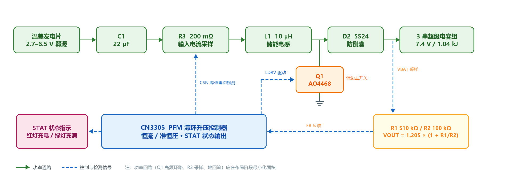
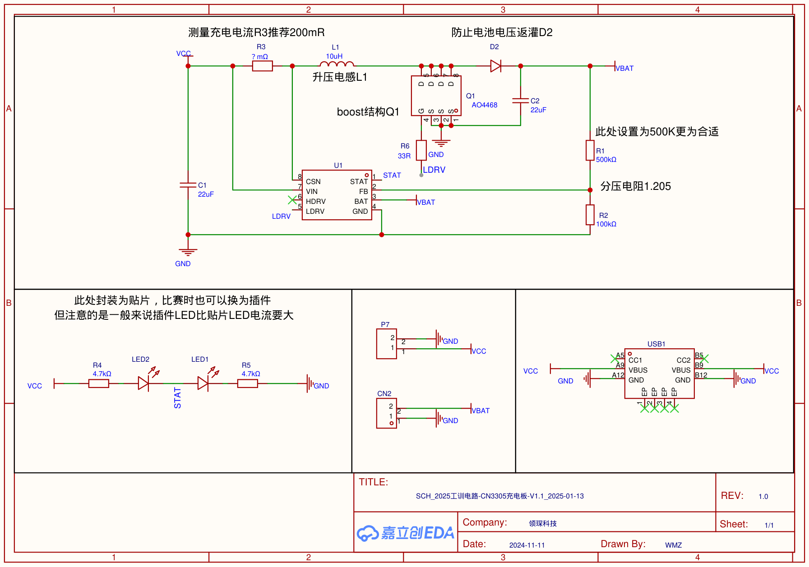
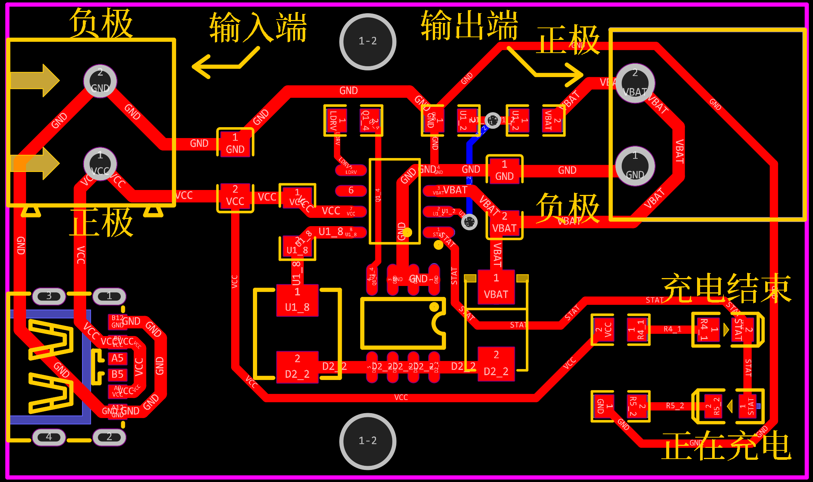

<div align="center">

# CN3305 升压式超级电容充电控制板

**PFM 滞环升压 · 2.7–6.5 V 弱源输入 · 7.4 V / 0.5 A 三串超级电容充电**

面向温差发电等弱源场景的充电控制板 —— 2025 年中国大学生工程实践与创新能力大赛
温差电动车赛项 · **国家级特等奖（亚军）** 参赛作品

[](LICENSE)


</div>



一句话概括：把温差发电片"又软又飘"的 2.7–6.5 V 低压输入，用一颗 CN3305 做 PFM 滞环升压，
恒流—准恒压两段式地把能量灌进 3 串超级电容组（标称 7.4 V），并用双色 LED 给出充电状态。
整板 49 × 29 mm、双面布局、全板只有 **2 个过孔**，为的是比赛现场的手工/半自动制板条件。

---

## 目录

- [项目背景](#项目背景)
- [硬件规格](#硬件规格)
- [工作原理](#工作原理)
- [关键参数设计](#关键参数设计)
- [实测结果](#实测结果)
- [原理图与 PCB](#原理图与-pcb)
- [复现指南](#复现指南)
- [仓库结构](#仓库结构)
- [BOM](#bom)
- [已知限制与改进方向](#已知限制与改进方向)
- [参考资料](#参考资料)
- [许可证](#许可证)

---

## 项目背景

温差发电片（TEG）的输出电压随冷热端温差漂移，内阻大、带载能力弱，属于典型的**弱源**：
直接把负载挂上去，电压立刻塌陷，能量取不出来。

赛题要求把这类不稳定低压输入升压后给超级电容储能，再由电容组驱动后级。由此确定三个设计约束：

1. **输入宽压、低至 2.7 V** —— 温差不足时输入电压很低，控制芯片必须能在 2.7 V 起振；
2. **恒流充电** —— 弱源不能强行拉大电流，否则输入电压塌到欠压点，充电反而停止；
3. **可制造性** —— 现场制板条件有限，尽量少的过孔、单面贴装友好的封装。

CN3305 恰好匹配：PFM 升压 + 电感峰值电流检测 + 准恒压（Quasi-CV）+ 输入自适应，
2.7–6.5 V 输入、最高 1 MHz、SOP-8、外围极少。

## 硬件规格

| 项目 | 参数 |
| --- | --- |
| 输入电压 | 2.7 – 6.5 V（CN3305 允许范围），标称工作点约 3 V 弱源输入 |
| 输入接口 | P7：5.08 mm 2P 接线端子；USB1：Type-C 6P，仅取 VBUS/GND 作扩展供电 |
| 输出 | 标称 7.4 V（FB 分压 1.205 V × (1 + R1/R2)），3 串超级电容组 |
| 平均充电电流 | ≈ 0.5 A（输入侧电感电流均值，由 R3 = 200 mΩ 设定；实测 0.53 A） |
| 控制方式 | PFM 滞环峰值电流限流 + 准恒压（Quasi-CV）两段式 |
| 开关频率 | 设计点 ≈ 450 kHz，芯片上限 1 MHz |
| 功率级 | Q1 AO4468（低边 N-MOS）+ L1 10 µH + D2 SS24（防倒灌） |
| 状态指示 | STAT 双色 LED：红灯 = 正在充电，绿灯 = 充电完成 |
| 保护 | 电池端过压保护（芯片内置）、D2 防倒灌、输入自适应；**无输入防反接** |
| PCB | 2 层，49.0 × 29.0 mm，双面布局，全板 2 个过孔 |
| EDA 工具 | 嘉立创 EDA 专业版（源工程见 `hardware/eda/`） |
| 实测 | 效率 81%，0 → 7.2 V 用时 6 min（储能 1.04 kJ），满载温升 23 ℃ |

## 工作原理

### 功率通路

`VCC → R3(200 mΩ) → L1(10 µH) → [Q1 对地开关 | D2] → VBAT（超级电容组）`

- **R3 串在功率通路里**：CN3305 通过 CSN/VIN 两端检测 R3 上的压降，得到电感电流，
  因此它既是"采样电阻"，也是效率账单上的一笔固定开销（见[性能复盘](#性能复盘)）。
- **Q1 是低边主开关**：导通时电感电流线性上升储能，关断时电感电流经 D2 续流给电容充电。
- **D2 防倒灌**：避免输入掉电时电容组电压倒灌回输入端。

### 恒流阶段

电感电流在"上限 / 下限"之间反复滞环：

- 电流升到上限（由 R3 设定）→ Q1 关断，能量转入电池；
- 电流降到下限 → Q1 重新导通。

由于电流被夹在这个窗口内，输入侧呈现**恒流源特性**——弱源不会被瞬间拉垮，这是该方案能在
温差片上持续取能的关键。CN3305 的输入自适应功能进一步在输入电压跌落时自动降低取能强度。

### 准恒压与充电终止

FB 引脚第一次达到 1.205 V（典型值）→ 进入准恒压模式，充电电流自动变小；
FB 第二次达到 1.205 V → 充电结束，Q1 保持关断，绿灯亮。
电容电压回落到再充电阈值后，芯片自动重新进入充电——即"自动再充电"。

> 两次触阈的设计，本质上是给"电池内阻 + 连接线电阻"造成的提前判满留了余量，
> 避免充电器在大电流下把线损误判成满电。

### 状态指示

STAT 为状态输出脚，本板用两颗 LED 把它接成互为反相的推挽指示：

```
VCC ── R4 4.7k ── LED2(绿) ──┬── STAT
                             │
              STAT ── LED1(红) ── R5 4.7k ── GND
```

- **充电中**：STAT 输出高 → 电流经 STAT → LED1(红) → R5 → GND，**红灯亮**，同时绿支路两端等电位而熄灭；
- **充电完成**：STAT 拉低 → 电流经 VCC → R4 → LED2(绿) → STAT 内部管 → GND，**绿灯亮**，红支路被旁路而熄灭。

两颗 LED 共用一条 STAT 线，不需要 MCU 参与，状态机对外完全透明。

## 关键参数设计

### 1. 采样电阻 R3：先定充电电流

手册给出的恒流设定关系（充电电流由采样电阻决定）：

$$R_{CS}=\frac{0.106}{I_{IN}}\quad(\Omega,\ A)$$

取 $I_{IN}=0.5\ \text{A}$ → $R_{CS}=0.212\ \Omega=212\ \text{m}\Omega$，选标称 **200 mΩ**。
实测平均充电电流 0.53 A，与设计值一致。

> 采样电阻不能随意改小：太小则电流上限抬高、弱源被拉垮；本板实测 200 mΩ 已能覆盖太阳能与
> 温差两种赛道的取能需求。

### 2. 储能电感 L1：电流纹波与开关频率的折中

由 $U=L\,\dfrac{di}{dt}$，在 Q1 导通区间取 $U=V_{IN}$、$\Delta i=\dfrac{0.123-0.087}{R_{CS}}=\dfrac{0.036}{R_{CS}}=0.18\ \text{A}$，
即可反解出电感量。按手册公式在 450 kHz、$V_{IN}=3\ \text{V}$、$V_D=0.5\ \text{V}$、
$R_{CS}=200\ \text{m}\Omega$、$V_{BAT}=7.4\ \text{V}$ 下计算得 $L\approx20.7\ \mu\text{H}$。

本板实装 **10 µH**（FXL0530-100-M，屏蔽贴片）。这里有一个容易被误解的点：**滞环控制下纹波
电流由比较器阈值锁定（≈±0.09 A），与电感量无关**——电感变小改变的是开关频率。按上式计算，
10 µH 对应约 1 MHz，正好顶到芯片的 1 MHz 上限，开关损耗相对 450 kHz 设计点翻倍：

| L | t<sub>on</sub> @3 V | t<sub>off</sub> @3 V | 估算 f |
| --- | --- | --- | --- |
| 10 µH（实装） | 0.60 µs | 0.37 µs | ≈ 1.03 MHz |
| 15 µH | 0.90 µs | 0.55 µs | ≈ 0.69 MHz |
| 20.7 µH（计算值） | 1.24 µs | 0.76 µs | ≈ 0.50 MHz |

换来的是更小的体积、更低的 DCR 与更高的饱和电流余量。完整推导见
[`docs/design-notes.md`](docs/design-notes.md)。

### 3. 反馈分压 R1/R2：定终止电压

$$V_{OUT}=1.205\times\left(1+\frac{R_1}{R_2}\right)$$

| R1 | R2 | 计算 V<sub>OUT</sub> | 说明 |
| --- | --- | --- | --- |
| 500 kΩ | 100 kΩ | 7.23 V | 原理图标注值 |
| 510 kΩ | 100 kΩ | 7.35 V | BOM 实装料号（0603WAF5103T5E） |

3 串超级电容单体按 2.4–2.5 V 留有安全余量，手册对外标称 7.4 V。
需要改终止电压时，**只动 R1**（保持 R2 = 100 kΩ），可单片微调。

## 实测结果

测试条件：温差发电片作为输入源，输出接 3 串超级电容组（0 V 起充）。

| 指标 | 实测值 | 备注 |
| --- | --- | --- |
| 充电时间 | 6 min（0 → 7.2 V） | 储能 1.04 kJ |
| 平均充电电流 | 0.53 A | 设计目标 0.5 A |
| 充电效率 | 81 % | 输入—输出能量比 |
| 满载温升 | 23 ℃ | 功率级与电感无明显热点 |
| 输出电压 | 7.23 – 7.35 V | 随 R1 实装值而定 |

### 性能复盘

1.04 kJ / 6 min ≈ 2.9 W 平均输出功率，按 81% 效率反推，平均输入功率约 3.6 W、总损耗约 0.7 W。
按器件手册参数做量级估算，损耗排序大致是：

1. **D2 肖特基正向压降**：0.5 A 量级下约 0.3–0.4 V，单项即可吃掉 0.15–0.2 W——异步整流的固有代价；
2. **Q1 开关损耗**：实装 10 µH 使开关频率接近 1 MHz，每个周期的开通/关断损耗被放大；
3. **R3 采样电阻**：串在功率通路中，输入电流越大 I²R 越显著——弱源场景下采样电阻不能取大，这是一对矛盾；
4. **L1 铜损与芯片静耗**：占比最小（CN3305 静态电流仅 280 µA @5 V）。

下一版如果追求效率，优先级是：**同步整流（MOS 替 D2）> 回到 20 µH 降频 > 减小 R3 并用运放放大 > 加大铜厚**。

## 原理图与 PCB

<div align="center">



<p><em>原理图（嘉立创 EDA 专业版，V1.1 / REV 1.0）</em></p>



<p><em>PCB 布局：左侧输入端（P7 端子 + Type-C），右侧输出端（CN2），右下角为状态指示灯</em></p>

</div>

布局要点：

- **Q1 高频环路面积最小化**：输入电容 C1 → L1 → Q1 → GND 的回流路径尽量短而宽；
- **采样走线单独走**：CSN/VIN 从 R3 两端开尔文引出，避免与功率电流共用铜皮；
- **过孔最少化**：全板仅 2 个过孔，规避现场制板孔径偏差导致的不良；
- **铺铜散热**：功率器件与电感焊盘大面积铺铜，实测满载温升 23 ℃。

## 复现指南

### 1. 打样

把 `hardware/gerber/cn3305-charger-v1.1-gerber.zip` 直接上传嘉立创/其他板厂下单：
2 层、板厚 1.6 mm、尺寸 49 × 29 mm。Gerber 内含板框（GKO）、阻焊、丝印、PTH 钻孔与飞针测试点。

### 2. 备料

按下方 [BOM](#bom) 在立创商城一键配单。**R3 的取值决定充电电流**，务必按你的输入源功率选：
弱源取 200 mΩ（≈0.5 A），输入功率充裕可适当减小。

### 3. 焊接与上电

1. 先焊 U1 / Q1 / L1 / D2 等功率器件，再焊阻容与端子；
2. 用**限流**直流电源从 3 V 缓慢升压，空载测 V<sub>OUT</sub> 应在 7.2–7.4 V；
3. 接入电容组后观察：红灯亮 = 正在充电，绿灯亮 = 充满；
4. 若起始电压低于 2.7 V 不启动，属正常欠压锁定，提高输入电压或增大 R3 即可。

> ⚠️ **禁止**把高于 6.5 V 的电源直接接到输入端：芯片会永久损坏。本板**没有输入防反接**，
> 上电前务必确认正负极。

## 仓库结构

```
.
├── README.md
├── LICENSE
├── docs/
│   ├── images/
│   │   ├── block-diagram.png        # 系统框图（本仓库自制）
│   │   ├── schematic.png            # 原理图预览
│   │   └── pcb-layout.png           # PCB 布局预览
│   ├── design-notes.md              # 设计推导、损耗分析与复盘
│   └── manual-cn3305-charger-v1.1-cn.pdf   # 使用说明书（中文，10 页）
└── hardware/
    ├── schematic/cn3305-charger-v1.1-schematic.pdf
    ├── pcb/cn3305-charger-v1.1-pcb.png
    ├── gerber/cn3305-charger-v1.1-gerber.zip
    ├── bom/cn3305-charger-v1.1-bom.xlsx
    ├── eda/cn3305-charger-v1.1-easyeda-pro.epro2   # 嘉立创 EDA 专业版源工程
    └── datasheets/CN3305-datasheet-cn.pdf          # 芯片手册（如韵电子）
```

## BOM

主要器件（完整配单见 `hardware/bom/cn3305-charger-v1.1-bom.xlsx`）：

| # | 位号 | 器件 | 规格 | 封装 | 立创编号 |
| --- | --- | --- | --- | --- | --- |
| 1 | U1 | CN3305 | PFM 升压充电控制器 | SOP-8 | C3034875 |
| 2 | Q1 | AO4468 | N-MOS，低边主开关 | SOP-8 | C87410 |
| 3 | L1 | FXL0530-100-M | 10 µH 屏蔽功率电感 | 5.4 × 5.2 mm | C177248 |
| 4 | D2 | SS24-E3/52T | 2 A / 40 V 肖特基，防倒灌 | SMB | C163209 |
| 5 | R3 | 采样电阻 | 200 mΩ（手册推荐；BOM 料号为 75 mΩ 档） | R1206 | C728502 |
| 6 | R1 / R2 | 分压电阻 | 510 kΩ / 100 kΩ | R0805 | C23192 / C25803 |
| 7 | R4 / R5 | LED 限流 | 4.7 kΩ | R0805 | C23162 |
| 8 | R6 | 栅极电阻 | 33 Ω | R0805 | — |
| 9 | C1 / C2 | 输入/输出电容 | 22 µF / 25 V X5R | C1206 | C5672 |
| 10 | LED1 / LED2 | 状态指示灯 | 红 / 绿 | 0805 | C72043 / C72044 |
| 11 | P7 | 输入端子 | 5.08 mm 2P | 插件 | C8465 |
| 12 | CN2 | 输出端子 | 5.08 mm 2P | 插件 | C5188019 |
| 13 | USB1 | Type-C 扩展口 | 6P 母座 | SMD | C709356 |

> BOM 备注：R1/R2/R4/R5 的料号为 0603 系列（`0603WAF...`）而焊盘标注为 0805，实际可贴装但需注意
> 焊盘略大；R6 未指定料号，任意 33 Ω / 1% 贴片电阻即可。

## 已知限制与改进方向

这是比赛现场版的电路，为了让同学们焊得动，做了不少取舍。已知问题：

| 问题 | 影响 | 改进 |
| --- | --- | --- |
| 无输入防反接 | 接反即损坏 | 输入端加 P-MOS 理想二极管 |
| Type-C 未接 CC 下拉 | C-to-C 线缆取不到电，需 A-to-C | 加 5.1 kΩ CC 下拉 |
| D2 异步整流 | 效率损失 4–5 个点 | 改同步整流 MOS |
| L1 = 10 µH（计算值 20.7 µH） | 开关频率升至 ~1 MHz 上限，开关损耗增加 | 换 15–22 µH |
| R3 非开尔文接法 | 200 mΩ 量级下焊盘/走线电阻带来读数偏差 | 四线采样 + 差分走线 |
| 无输出过压/TVS | 仅靠芯片内置保护 | 加 TVS + 输出 OVP |
| 无输入过压钳位 | 输入 > 6.5 V 损坏芯片 | 加 TVS/齐纳钳位 |

## 参考资料

- [CN3305 数据手册（如韵电子）](hardware/datasheets/CN3305-datasheet-cn.pdf) —— PFM 升压多节电池充电控制 IC
- [本板使用说明书 V1.1](docs/manual-cn3305-charger-v1.1-cn.pdf) —— 接口、参数计算与常见问题（中文，10 页）
- [设计笔记](docs/design-notes.md) —— 本文档中所有计算的完整推导与损耗估算

## 许可证

本仓库采用 [MIT License](LICENSE)。

原理图、PCB、Gerber 与 EDA 源工程由作者独立设计，可自由用于学习、复现与二次开发；
芯片数据手册与使用说明书的著作权归各自原作者（如韵电子 / 领琛科技），仅作学习参考转载。

## 致谢

- 如韵电子 CN3305 —— 一颗外围极少、非常适合教学与竞赛的升压充电控制器；
- 2025 年中国大学生工程实践与创新能力大赛 温差电动车赛项 的裁判与队友。

---

## English Summary

A 2-layer, 49 × 29 mm PFM boost charger for 3-cell supercapacitor banks, built around the
Consonance **CN3305**. It lifts a weak 2.7–6.5 V source (thermoelectric generator) to a
7.4 V nominal rail with hysteresis peak-current CC charging and quasi-CV termination.
Measured: 81 % efficiency, 0 → 7.2 V in 6 min (1.04 kJ stored), 23 ℃ temperature rise,
0.53 A average charge current. Schematic, PCB, Gerber, BOM and the EasyEDA Pro source project
are all included. Licensed MIT.
